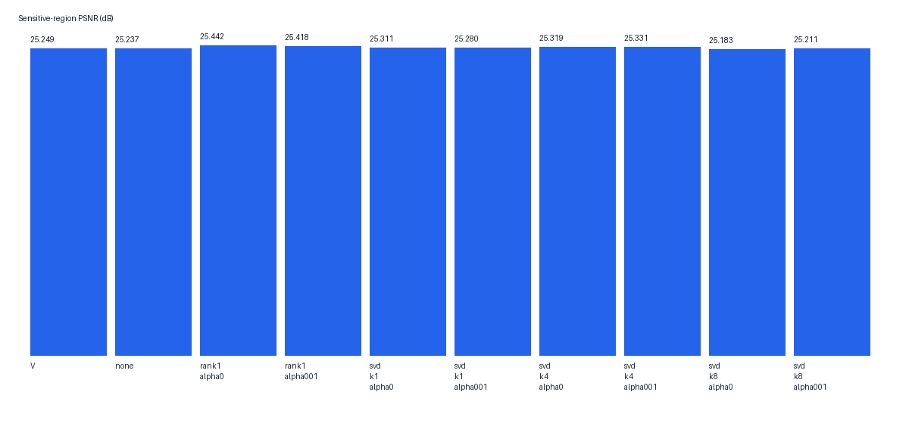
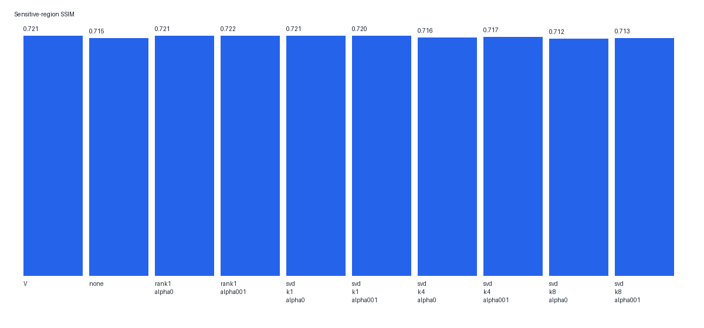
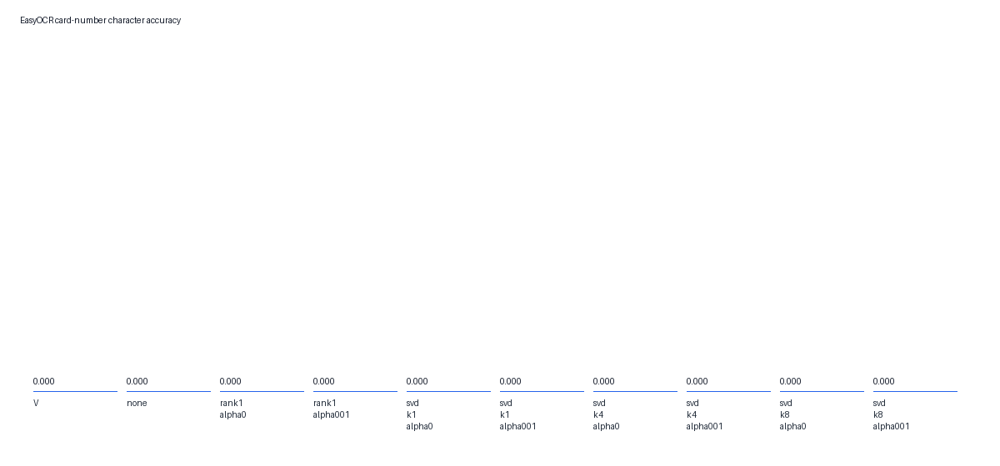
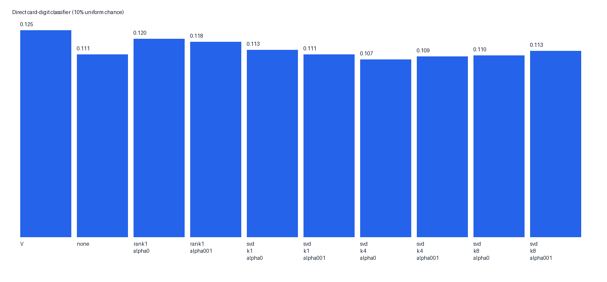

# Inversion attack benchmark

Measured on 500 Playwright-rendered synthetic pages: 400 training and 100
held-out, split by page. Every metric below uses held-out pages. Inputs follow
the exact rank-64 source-PCA wire path: source-grid sanitization, PCA
projection, per-row int8, zlib/Base64 JSON, then backend decode and rebuild to
`[576,1152]`. All ten decoder models used the same convolutional architecture
and two training epochs on CPU.

Setup: seed 26171; Python 3.12.10, NumPy 2.5.3, PyTorch 2.14.0+cpu, ONNX
Runtime 1.31.1; FP32 model size 343,344,204 bytes; EasyOCR 1.7.2. PSNR and
SSIM are computed on the sensitive-patch mask. OCR values are the mean of
per-page normalized character-edit accuracy. The direct digit probe is ridge
regression on global-mean latent features.

| Representation | PSNR (dB) | SSIM | EasyOCR password char acc. | EasyOCR card char acc. | Digit attack char acc. | Chance | Train-majority baseline |
|---|---:|---:|---:|---:|---:|---:|---:|
| V | 25.249 | 0.7213 | 0.000 | 0.000 | 0.125 | 0.100 | 0.099 |
| Vprime_none | 25.237 | 0.7146 | 0.000 | 0.000 | 0.111 | 0.100 | 0.099 |
| Vprime_rank1_alpha0 | 25.442 | 0.7209 | 0.000 | 0.000 | 0.120 | 0.100 | 0.099 |
| Vprime_rank1_alpha001 | 25.418 | 0.7218 | 0.000 | 0.000 | 0.118 | 0.100 | 0.099 |
| Vprime_svd_k1_alpha0 | 25.311 | 0.7208 | 0.000 | 0.000 | 0.113 | 0.100 | 0.099 |
| Vprime_svd_k1_alpha001 | 25.280 | 0.7203 | 0.000 | 0.000 | 0.111 | 0.100 | 0.099 |
| Vprime_svd_k4_alpha0 | 25.319 | 0.7164 | 0.000 | 0.000 | 0.107 | 0.100 | 0.099 |
| Vprime_svd_k4_alpha001 | 25.331 | 0.7172 | 0.000 | 0.000 | 0.109 | 0.100 | 0.099 |
| Vprime_svd_k8_alpha0 | 25.183 | 0.7123 | 0.000 | 0.000 | 0.110 | 0.100 | 0.099 |
| Vprime_svd_k8_alpha001 | 25.211 | 0.7133 | 0.000 | 0.000 | 0.113 | 0.100 | 0.099 |

As an OCR control, EasyOCR on the original held-out screenshots (before
embedding or reconstruction) achieved 0.000 password and 0.0025 card
character accuracy. Therefore, the zero reconstruction OCR scores are
uninformative about sanitization effectiveness: this OCR setup could not
reliably read the source pages either.

## Charts

## Interpretation and limitations

This experiment does not establish that `V'` is non-invertible or private.
The digit probe scored 10.75–12.00% for sanitized representations against
10.00% uniform chance and a 9.875% training-majority baseline, while the
unsanitized `V` scored 12.50%. The short two-epoch decoders reconstructed
sensitive regions at 25.18–25.44 dB PSNR and 0.7123–0.7218 SSIM; those image
metrics do not establish credential recovery. EasyOCR was at its floor on the
original screenshots, so it cannot support a privacy conclusion here.

Results are limited to this synthetic dataset, this decoder and attack probe,
two training epochs, and one OCR engine. More capable attackers, other pages,
or real-world sensitive content were not evaluated.
